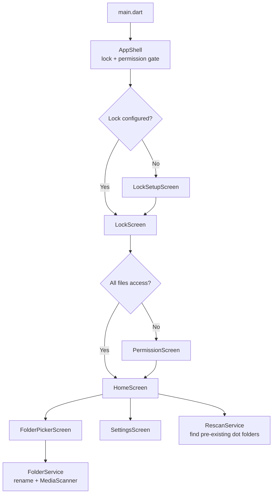

# DotHide

DotHide hides folders on Android by adding a `.` (dot) to the front of the folder name.
`.MyFolder` is skipped by galleries and file browsers, so the folder disappears from view
without being moved, encrypted, or modified.

Unhiding removes the dot, and the folder is visible again.

- **No moving files.** Only `Directory.rename()` is used — one rename per action.
- **No encryption or file processing.** The contents of a folder are never read.
- **No per-file index.** Only the parent folder paths are stored, in `SharedPreferences`.
- **Works offline.** No network calls, no analytics, no telemetry.

---

## Tech stack

| Layer | Technology |
| --- | --- |
| Language | Dart 3.13+ (`sdk: ^3.13.1`) |
| Framework | Flutter 3.47 (stable channel), Material 3 |
| Platform | Android only — `minSdk 24`, `targetSdk 36` |
| Build | Gradle (Kotlin DSL), AGP + Kotlin JVM target 17 |
| State management | Plain `StatefulWidget` + `setState` (no state-management package) |
| Persistence | `shared_preferences` |
| Cryptography | `crypto` — salted SHA-256 for the unlock secret |
| Permissions | `permission_handler` (pinned `12.0.3`) |
| Biometrics | `local_auth` |
| Media indexing | `media_scanner` (refreshes Android `MediaStore` after a rename) |
| Path utilities | `path` |
| Testing | `flutter_test` |
| Linting | `flutter_lints` via [analysis_options.yaml](analysis_options.yaml) |

### Dependencies

```yaml
dependencies:
  permission_handler: 12.0.3   # MANAGE_EXTERNAL_STORAGE on Android 11+
  shared_preferences: ^2.5.6   # the hidden-folder path list
  media_scanner: ^2.2.1        # MediaStore refresh after a rename
  local_auth: ^3.0.2           # fingerprint shortcut
  crypto: ^3.0.8               # SHA-256 for PIN / password / pattern
  path: ^1.9.1                 # basename / dirname helpers
```

> `permission_handler` is pinned to `12.0.3`. `permission_handler_android` 14.x requires
> `compileSdk 37`, which is not resolvable on this setup.

### Android permissions

Declared in [AndroidManifest.xml](android/app/src/main/AndroidManifest.xml):

| Permission | Purpose |
| --- | --- |
| `MANAGE_EXTERNAL_STORAGE` | Rename folders anywhere in shared storage (Android 11+) |
| `READ_EXTERNAL_STORAGE` | Legacy read access (API 23–32) |
| `WRITE_EXTERNAL_STORAGE` | Legacy write access (API ≤ 29) |
| `USE_BIOMETRIC` | Fingerprint unlock shortcut |
| `USE_FINGERPRINT` | Fingerprint on API ≤ 27 |

### Architecture at a glance



| Path | Responsibility |
| --- | --- |
| [lib/app.dart](lib/app.dart) | Root shell: mandatory lock, permission gate, re-lock on resume |
| [lib/screens/](lib/screens) | Onboarding, lock, permission, home, folder picker, settings |
| [lib/services/folder_service.dart](lib/services/folder_service.dart) | Hide/unhide by toggling the dot prefix |
| [lib/services/hidden_store.dart](lib/services/hidden_store.dart) | Persists the hidden folder path list |
| [lib/services/lock_store.dart](lib/services/lock_store.dart) | Salted SHA-256 lock storage |
| [lib/services/rescan_service.dart](lib/services/rescan_service.dart) | Finds dot-folders after a reinstall |
| [lib/services/permission_service.dart](lib/services/permission_service.dart) | All-files access checks and requests |
| [lib/services/media_scanner_service.dart](lib/services/media_scanner_service.dart) | Best-effort `MediaStore` refresh |
| [lib/services/biometric_service.dart](lib/services/biometric_service.dart) | Fingerprint availability and auth |
| [lib/widgets/](lib/widgets) | `PinPad`, `PatternLock`, verify dialog, empty states |
| [lib/theme/app_theme.dart](lib/theme/app_theme.dart) | Grey/white monochrome light + dark themes |

### Build and test

```bash
flutter pub get
flutter analyze
flutter test
flutter run
flutter build apk --release
```

---

## User manual

### Requirements

- An Android device running **Android 7.0 (API 24)** or newer.
- "All files access" granted to DotHide (Android 11+ shows this as a special permission,
  not a normal dialog).
- Android 13+ may also require allowing the install of the build you are testing.

### 1. First launch — set up the app lock

One of **PIN**, **Password**, or **Pattern** is mandatory. DotHide cannot be used without it.

1. Open DotHide. The **Set up app lock** screen appears.
2. Choose a method:
   - **PIN** — 4–6 digits. Pick the length, enter the PIN, then re-enter it to confirm.
   - **Password** — at least 6 characters, entered twice.
   - **Pattern** — connect at least 4 dots on a 3×3 grid, drawn twice.
3. If the two entries do not match, the setup resets and you start over.

If the device has an enrolled fingerprint, the fingerprint shortcut is switched on
automatically after setup. It can be turned off in Settings.

> The secret is stored only as a salted SHA-256 digest. The plaintext is never written to disk.

### 2. Grant file access

After unlocking for the first time, DotHide asks for file access.

1. Tap **Grant access**.
2. Android opens the **All files access** page for DotHide.
3. Enable the toggle, then press Back. DotHide re-checks automatically on return.

If access is refused, the button changes to **Open settings** so you can enable it manually.
While access is missing, the home screen shows a banner and hiding is unavailable.

### 3. Hide a folder

1. On the home screen, tap **Hide folder**.
2. Browse to the folder: tap a folder to open it, tap ↑ to go up one level.
3. Tap **Hide this folder** at the bottom.

The folder is renamed `MyFolder` → `.MyFolder` and is added to the list on the home screen.
`MediaStore` is refreshed so the folder disappears from galleries and file apps right away.

Folders that are already hidden, and the storage root itself, cannot be selected.

### 4. Unhide a folder

1. On the home screen, find the folder in the list.
2. Tap **Unhide** (or tap the row) and confirm.

The dot is removed — `.MyFolder` → `MyFolder` — and the folder becomes visible again.
The MediaStore refresh is repeated so the gallery picks it up immediately.

### 5. Rescan after reinstalling

The hidden list lives in app storage, so reinstalling DotHide loses it. The folders stay
hidden on disk because the dot is part of the name.

1. Tap the **refresh** icon in the app bar.
2. DotHide searches shared storage (up to 3 levels deep, capped for speed) for
   dot-prefixed folders it does not already know.
3. Tick the folders you want to manage, then tap **Add**.

Android system dot-folders (`.thumbnails`, `.trashed`, `.cache`, …) are ignored, and the
scan never descends into a hidden folder.

### 6. Unlock and re-lock behaviour

- The lock screen appears on every cold start.
- Returning to the app also re-locks it, after a **5-second grace period** so that
  switching to the system settings page or the folder picker does not force a re-unlock.
- **Use fingerprint** unlocks instantly when enabled. If the fingerprint fails, is
  cancelled, or the sensor is unavailable, the mandatory method stays on screen.
- After 5 failed attempts a reminder ("Too many failed attempts. Take your time.") is shown.
  There is no lockout — the prompt stays available.

### 7. Settings

Tap the **gear** icon on the home screen.

| Option | Behaviour |
| --- | --- |
| **Unlock method** | Verify the current secret, then choose a new PIN / password / pattern |
| **Fingerprint shortcut** | Enable or disable. Only available when a mandatory method exists and a fingerprint is enrolled |
| **How hiding works** | Short in-app explanation of the dot trick |
| **After reinstalling** | Reminder to use **Rescan** |
| **Version** | Installed version number |

### Troubleshooting

| Symptom | Cause and fix |
| --- | --- |
| "Permission denied" when hiding | All-files access was revoked. Re-grant it and retry. |
| "Folder is already hidden" | The name already starts with a dot — unhide it instead. |
| "… already exists in this location" | A folder or file with the target name exists. Rename or remove it first. |
| "The folder is in use by another app" | Close the app using the folder (file manager, media app) and retry. |
| "Missing on device" on a row | The folder was moved or deleted outside DotHide. The entry is pruned on the next refresh. |
| Hidden folder still visible in a gallery | Some gallery apps cache results. Force-stop the gallery or rescan in DotHide. |
| Folder not found after reinstall | Use **Rescan** on the home screen. |

### Notes and limitations

- Hiding is a **name change, not security**. Dot folders are skipped by media scanners and
  most file browsers, but any app with storage access can still read them. DotHide is not
  a vault and does not encrypt anything.
- Hiding is **not recursive per file** — the whole folder is hidden by its name.
- Nested content is untouched, including file timestamps.
- Anything that recreates a folder with its original name makes the old entry stale; the
  list prunes missing paths on load.
- The app is Android-only and locked to portrait orientation.

---

## Tests

```bash
flutter test
```

- [test/lock_store_test.dart](test/lock_store_test.dart) — type storage, verification,
  salted hashing, no plaintext on disk, method replacement, fingerprint gating.
- [test/folder_service_test.dart](test/folder_service_test.dart) — dot toggling, untouched
  contents, error cases, `RescanService` filtering and depth limits.
